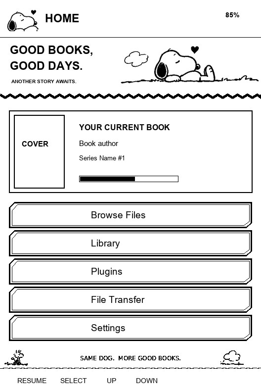
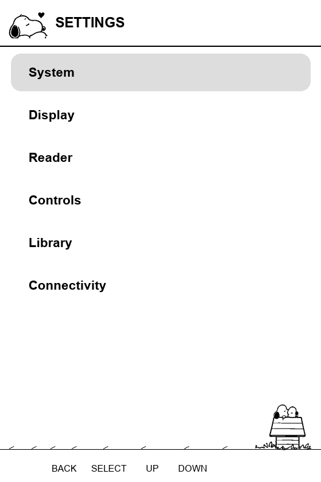

# Snoopy — CrossPoint Theme Collection

An unofficial, cozy **SD-loaded theme** for compatible CrossPoint e-readers. Snoopy, Woodstock, rounded menus, DynaPuff typography, a live Continue Reading card, grayscale sleep scenes, and a themed USB screen — all without replacing the firmware.

**[Download the latest release](https://github.com/jadehawk/snoopy.crosspoint-theme/releases/latest)** · [View Halo's companion theme example](https://github.com/jadehawk/halo.crosspoint-theme) · [Theme publishing contract](https://github.com/jadehawk/halo.crosspoint-theme/blob/main/docs/THEME_CONTRACT.md)

> **Compatibility:** A firmware build must advertise the required `theme.*` capabilities. This is a **theme pack**, not an executable plugin, wallpaper-only pack, or firmware image. The firmware retains navigation, library, reader, clock/battery indicators and touch actions. Do not assume a stock firmware build can load SD themes.

## Preview

These are **illustrative concept previews**, not exact firmware screenshots; real text, book covers, menu layout, and status indicators are rendered by the firmware.

| Home | Settings | Sleep |
|:---:|:---:|:---:|
|  |  |  |

## Features

- **Snoopy and Woodstock UI:** themed header and menus, original illustrated footer and boot imagery, and navigation that follows the firmware.
- **Continue Reading:** native cached book cover, live title/author, available series details and saved reading progress — not a static mockup.
- **DynaPuff fonts:** four device-ready monochrome UI font slots; fonts inside books remain your own choice.
- **Ten rotating grayscale sleep scenes:** native four-tone artwork for the firmware's Dark/Light sleep mode, distinct from Custom wallpaper pools.
- **USB connection art:** full-screen four-tone illustration, with a monochrome fallback on unsupported displays.
- **Native header actions:** compatible firmware keeps the clock top-left and battery top-right, and retains the Back arrow beside the emblem on touch screens.

## Choose the package for your device

Both variants share the same theme identity and version. One GitHub release contains the two **installable ZIPs**:

| Package | Display profile | Packaging |
|---|---|---|
| `snoopy-x3-<version>.crosspoint-theme.zip` | XTEink X3 · 528 × 792 | Uncompressed ZIP entries for the X3's limited internal RAM |
| `snoopy-x4plus-<version>.crosspoint-theme.zip` | X4Plus/X4Pro-compatible · 480 × 800 | Compressed ZIP with the corresponding touch-screen artwork |

Choose by **screen resolution and supported capabilities**, not just the model name. Do not combine the two packages.

## Installation

**Option A — Theme catalog:** On a compatible firmware version with a theme-capable Plugin Hub, install Snoopy from the catalog when listed.

**Option B — Manual installation:**

1. Download the device-matched ZIP from the [latest release](https://github.com/jadehawk/snoopy.crosspoint-theme/releases/latest).
2. **Extract** its `snoopy.crosspoint-theme/` folder to the SD card under `/.crosspoint/themes/`. Do not copy the ZIP itself into the theme folder.
3. Verify the file `/.crosspoint/themes/snoopy.crosspoint-theme/manifest.json` exists, with no extra nested directory.
4. Restart the reader. Open **Settings → Display → UI Theme → Snoopy**.
5. To use the included rotating sleep images, choose **Dark** or **Light** under Sleep Screen. Custom/Cover modes use their own source.

If the UI Theme setting is missing, the firmware may not support SD theme collections. The built-in theme remains the fallback.

## Repository layout

```text
snoopy.crosspoint-theme/                GitHub repository
├── snoopy.crosspoint-theme/            Only installed payload
│   ├── manifest.json                   Capabilities, files, version
│   ├── README.md                       Short on-device description
│   ├── DETAILS.md                      Catalog details and font license
│   └── themes/snoopy/
│       ├── theme.json                  Authoritative appearance/layout
│       ├── assets/                     Committed CPB + USB BMP artwork
│       └── fonts/                      Committed CPFONT files
├── source-art/                          Editable illustrations and approved BMPs
│   └── release-sleep/{x3,x4plus}/       Committed native grayscale sleep art
├── source-fonts/                        Font sources and OFL license
├── previews/                            Illustrative previews
├── tools/
│   ├── build.py                         Artwork authoring only
│   ├── pack_theme_variants.py           Release packaging (read-only sources)
│   └── prepare_sleep_grayscale.py       Device-specific sleep BMP conversion
├── tests/                               Package and source validation
└── .github/workflows/
    ├── validate-theme.yml              Pull request, main and tag checks
    └── release.yml                     Automatic publication on v* tags
```

## Build and validate (theme authors)

Python 3.12+ and Pillow are sufficient for the device-specific packaging workflow.

```powershell
python -m pip install Pillow
python tools/pack_theme_variants.py
python -m unittest discover -s tests -p "test_*.py" -q
```

The packager reads committed theme files and **the already-approved, device-specific sleep BMPs**, validates each image, and writes **only installable ZIPs**. It does **not** regenerate or replace the checked-in `theme.json`, manifest, README, CPBs, USB art or sleep art. Image conversion remains an explicit, separate authoring step. Unlike the packager, `python tools/build.py` is an **authoring tool** that intentionally regenerates artwork and illustrative previews; review/commit resulting asset changes before publication.

## Release process

Like [Halo](https://github.com/jadehawk/halo.crosspoint-theme), Snoopy uses an immutable, versioned publishing flow:

1. Update the committed manifest version and relevant notes; make and test any artwork/layout changes.
2. Push the reviewed changes to `main`.
3. Push a matching `vMAJOR.MINOR.PATCH` Git tag.
4. GitHub Actions validates both packages and publishes **one non-draft release containing the X3 and X4Plus ZIPs**, titled simply `Snoopy vMAJOR.MINOR.PATCH`.

A release never runs `tools/build.py`, regenerates checked-in theme metadata or overwrites this GitHub README. **Releases are only created for new matching tags**; routine documentation/tooling edits need no new theme version.

## Limitations and credits

Snoopy is a declarative UI theme. It cannot introduce firmware features, executable scripts, new physical-button behavior, custom reader controls, or custom wallpaper modes. All firmware-owned interactions remain unchanged.

This is an **unofficial, non-commercial fan-made adaptation** featuring AI-generated illustrations. Snoopy, Woodstock, and other Peanuts characters are trademarks and copyrighted works of their respective owners. This project is not affiliated with or endorsed by the Peanuts rights holders or CrossPoint maintainers.

DynaPuff is by the **DynaPuff Project Authors**, under the **SIL Open Font License 1.1**; the license text is included in the distributed `DETAILS.md`. Thanks to the CrossPoint and FreeInkUI contributors for the underlying reader and theme platform.
